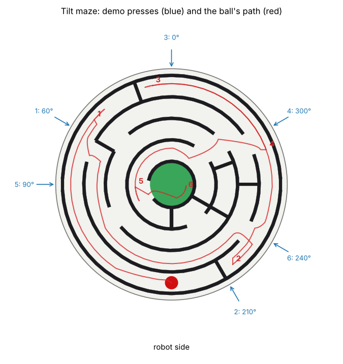

# Roll a ball through a tilting maze to its centre

A round maze board sits on a universal joint between the arms. A red ball lies in its outer channel under a clear
lid. The robot can only move the ball by pressing the lid's edge down, which tilts the board toward that side, and
the ball has to reach the green centre through four ring-shaped channels with dead ends.

Why it is hard, by construction:

- **Planning, not pushing.** The way in with the fewest presses rolls the ball *away* from the centre first: from
  the second channel back out into the other half of the outer one, round to where the gaps in three walls line up.
  Rocking between any two directions never gets the ball beyond the second channel from the outside (checked in
  `test_tilt_maze.py`). Random tilting (30 presses toward random sides) leaves the ball in the outer channel, scoring
  0, in about 9 runs out of 10 and never reaches the centre.
- **Both arms.** The two arms stand 61 cm apart and the board is 28 cm across: the left arm can press the rim from 0
  to 255 degrees (counterclockwise from the far side), the right from 105 to 360, so presses on the left side
  (15-90 degrees) need the left arm and on the right side (270-345) the right. The demo's route uses both.
- **Non-prehensile, closed loop.** The ball can't be touched (the lid covers it), so every move is chosen by watching
  where the last tilt left it.



## Files

| File | What |
|---|---|
| `task.py` | The yam_arena task file: objects, `success()`, `score()` and the open-loop `demo()` for `--policy yam_scripted` |
| `maze.py` | The maze's geometry (walls, gaps, spokes, pivot, stand), the scorer's rings and the route; pure Python |
| `mazekit.py` | The board (one body with many colliders, on a joint to the world) and the ball, for yam_arena task files |
| `plan.py` | A 2D model of the ball under a tilt, and a planner of presses over it |
| `demo.py` | The closed-loop scripted demo: re-plans from the ball's actual position after every press |
| `test_tilt_maze.py` | Offline checks (no GPU): geometry, scoring, the demo's presses, random and rocking baselines, reach |
| `make_cad.py`, `cad/` | Build files from the same tables: `maze_board.stl`, `maze_plan.svg` (1:1), `maze_plan.dxf`, `maze_lid.dxf` |

`mazekit.py` hooks `yam_arena.scene` without modifying yam_arena, so the task runs with the standard `yam_arena`
embodiment and `task_score` scorer.

## Run a trial

In the Isaac Lab-Arena environment from the simulation walkthrough, from this folder:

```bash
inspect-robots run --embodiment yam_arena --policy dream \
  -E task=task.py -E object_jitter=0 -E control_hz=20 -E cam_width=320 -E cam_height=176 \
  --instruction "Roll the red ball through the maze into the green centre by pressing down on the edge of the clear lid to tilt the board." \
  --scorer task_score --max-steps 2400 --store-frames --log-dir ~/yam-eval/maze-dream
```

`task_score` prints the trial's score: 1.0 on success, otherwise `score()` at the end of the episode.

## Scripted demo

Open loop, the walkthrough's way (the same command with `--policy yam_scripted --max-steps 1600`): six presses at
60, 210, 0, 300, 90 and 240 degrees, each taking the board down onto its stand (7 degrees) and holding it 5.5 s.
About 65 s (1,300 steps).

Closed loop, which re-plans from where the ball actually stopped and holds each press until the ball is still:

```bash
python demo.py task.py demo_out        # writes demo_top_cam.mp4 (and the wrist cameras), setup.png, result.json
```

Both arms start by moving to a parked pose over their own side; for each press, the arm that reaches that side goes
above the rim, comes down onto the lid, presses the board onto its stand, holds, and lifts so the board levels. The
other arm stays parked. The demo uses the simulator's ball position, which a scripted demo may.

## Scoring

Evaluated every control step; the score at the end of the episode counts (`SCORE_OVER = "end"`). By the distance of
the ball's centre from the board's centre, in the board's own frame (so the board's tilt doesn't matter):

| Ball's centre | Where | Score |
|---|---|---|
| under 2.8 cm, at rest (under 2 cm/s) for 1 s | the green centre cell | 1.0 (success) |
| 2.8 to 5.4 cm | innermost channel | 0.75 |
| 5.4 to 8.0 cm | | 0.5 |
| 8.0 to 10.6 cm | | 0.25 |
| over 10.6 cm | outer channel, where it starts | 0 |

The ring boundaries are the walls' centre lines, so a ball in a gap counts for the side its centre is on. In the real
world this is read from a top photo through the clear lid. A ball outside the walls (only possible with the lid off)
scores 0, as does a run where the lid was lifted or the board taken off its joint.

## Runtime and seeds

About 2 minutes per trial for the full 2,400 steps on an L40S, plus about 1 minute for Isaac Sim to start (6 minutes
on a fresh instance). The layout is fixed (`-E object_jitter=0`; nothing in the task is jittered in any case: the
board is pinned and the ball must start on its mark). There are no seeds to choose. `plan.py` is deterministic.

## Checks without a GPU

```bash
python -m pytest test_tilt_maze.py -q      # about 1 minute; the task-file and reach checks need yam_arena installed
```

The layout was picked by a random search over gap and spoke positions in `plan.py`'s model, keeping layouts that
are solvable in a few presses, that two-direction rocking cannot solve, whose route is over 55 cm, and that random
tilting rarely gets out of the outer ring.

## Fidelity

Rigid bodies. The board is one body held to the world by a joint at the universal joint's pivot (both tilts free,
twist and sliding locked). Its tilt is stopped by contact with the stand tube's rim at 7 degrees, as in the real build;
the joint's own limit (8.5 degrees) is only a backstop. The gimbal's pin friction is angular damping and the ball's
rolling resistance is linear and angular damping. Each curved wall is a row of straight boxes, at most 0.2 mm off
the true arc. The lid collides but is not drawn. The ring weight and the joint are drawn without colliders; the
board's mass (0.90 kg) and centre of mass (3 cm below the pivot) include them.

## Real-world build

| Part | Build |
|---|---|
| Base and walls | `cad/maze_board.stl`, PLA, light grey base, black walls (print the walls in black from the base's top layer, or paint them). 280 mm: print on a 300 mm bed, or cut it into quarters in the slicer and glue. Paint the centre cell green. Or laser-cut 6 mm plywood for the base and stack three 6 mm black acrylic layers cut from `cad/maze_plan.dxf` for the walls, placed on the 1:1 `maze_plan.svg` printout. |
| Lid | 3 mm clear acrylic, `cad/maze_lid.dxf` (a 280 mm disc), held by four strips of clear tape |
| Ball | 16 mm red glass marble (about 5.4 g); mark its start with the red circle on `maze_plan.svg` |
| Joint | a small steel universal joint (about 16 mm across), its upper yoke in a boss glued under the base's centre so the joint's centre is 16 mm below the floor, its lower yoke on a post |
| Stand | a PLA tube, 100 mm outer diameter, 47.8 mm tall, screwed or taped to the table, holding the post so the floor is 60 mm above the table; the base's underside clears its rim by 6 mm when level and lands on it at 7 degrees |
| Weight | a steel ring (about 80 mm across) hung under the base inside the tube, sized so the board weighs 0.90 kg with its centre of mass 3 cm below the joint's centre: the board then swings back level when let go |

Real-world trials are safe: the board moves 7 degrees at most, the ball is enclosed, and nothing is sharp or heavy.
